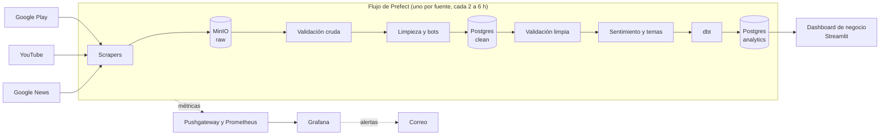

# Radar de Marca: Rappi

[](https://github.com/Michruiz2710/Radar-de-marca-Rappi/actions/workflows/ci.yml) [](https://github.com/Michruiz2710/Radar-de-marca-Rappi/actions/workflows/cd.yml)

Pipeline DataOps de escucha activa que recolecta lo que se dice de Rappi en Google Play, YouTube y Google News, valida y analiza esos datos, alerta cuando algo falla o el sentimiento negativo se dispara, y lo muestra en un dashboard de negocio.

Proyecto grupal del curso **Enfoque DataOps**, Escuela Colombiana de Ingeniería Julio Garavito, noviembre de 2026.

> Proyecto académico. No está afiliado, patrocinado ni avalado por Rappi. Rappi se usa únicamente como caso de estudio con datos públicos de plataformas de terceros.

## Qué problema resuelve

El equipo de una marca como Rappi recibe cientos de reseñas y comentarios al día y nadie alcanza a leerlos. Cuando una actualización de la app rompe algo o hay una polémica, se entera tarde. Este pipeline lo hace solo, cada pocas horas:

1. **Recolecta** reseñas de Google Play, comentarios de YouTube y titulares de Google News.
2. **Guarda** los datos crudos en MinIO, con los autores seudonimizados.
3. **Valida** la calidad de los datos con Great Expectations.
4. **Limpia**, enmascara datos personales, marca bots y calcula **sentimiento y tema** de cada texto.
5. **Construye** tablas analíticas con dbt.
6. **Mide** la salud del pipeline y **avisa por correo** cuando algo falla.
7. **Muestra** el resultado en un dashboard de negocio.

El dashboard responde cinco preguntas: ¿cuántas menciones hay y qué tan negativas son?, ¿cómo cambia el sentimiento día a día y por fuente?, ¿de qué se queja más la gente?, ¿qué versión de la app gustó menos? y ¿cuánto tarda Rappi en responder las reseñas negativas?

## Arquitectura



- **Capas:** raw (archivos JSON Lines en MinIO, tal como llegan), clean (una fila por mención, limpia y sin datos personales visibles) y analytics (tablas de dbt para el dashboard).
- **Orquestación:** Prefect corre un flujo por fuente: noticias cada 2 horas, Google Play cada 3 y YouTube cada 6. Si una validación crítica falla, el flujo se detiene.
- **Entornos:** dev (Docker de cada integrante), staging (al fusionar en `main`) y prod (al publicar una release), cada uno con su bucket y sus esquemas.
- **Detalle:** [`docs/linaje.md`](docs/linaje.md) sigue una mención de punta a punta y [`docs/catalogo_datos.md`](docs/catalogo_datos.md) describe cada tabla.

## Servicios

| Servicio | Para qué | Dirección |
| --- | --- | --- |
| MinIO | Capa raw | http://localhost:9001 |
| Postgres | Capas clean y analytics | `localhost:5432` |
| Prefect | Orquestación: flujos, corridas y logs | http://localhost:4200 |
| Pushgateway y Prometheus | Métricas del pipeline | http://localhost:9091 y http://localhost:9090 |
| Grafana | Dashboard técnico y alertas | http://localhost:3000 |
| Streamlit | Dashboard de negocio | http://localhost:8502 |
| dbt docs | Documentación y linaje de los modelos (`make dbt-docs`) | http://localhost:8080 |

## Cómo levantar el proyecto

**Requisitos:** Docker Desktop (el orquestador usa hasta 4 GB de memoria), Python 3.11, Git y `make`. En Windows, usa Git Bash e instala `make` con `winget install ezwinports.make`.

```bash
git clone https://github.com/Michruiz2710/Radar-de-marca-Rappi.git
cd Radar-de-marca-Rappi
cp .env.example .env        # completa las credenciales (nunca subir .env)
make up                     # construye y levanta todos los servicios
```

En `.env` hay que completar como mínimo:

| Variable | Qué es |
| --- | --- |
| `MINIO_ROOT_USER`, `MINIO_ROOT_PASSWORD` | Credenciales de MinIO |
| `POSTGRES_USER`, `POSTGRES_PASSWORD` | Credenciales de Postgres (sin `@`, `:` ni `/`) |
| `HASH_SALT` | Sal para seudonimizar autores. Debe ser la misma para todo el equipo y se comparte solo por privado |
| `YOUTUBE_API_KEY` | Clave de la API de YouTube Data v3 |
| `GRAFANA_ADMIN_PASSWORD` | Contraseña del usuario `admin` de Grafana |
| `ALERTAS_CORREO_DESTINO`, `GRAFANA_SMTP_USER`, `GRAFANA_SMTP_PASSWORD` | A quién llegan las alertas y desde qué cuenta salen (ver [`infra/grafana/README.md`](infra/grafana/README.md)) |

La primera vez `make up` tarda más de 10 minutos, porque la imagen del orquestador incluye el modelo de sentimiento. Las siguientes reutilizan la caché.

**Si el correo de alertas falla** con `EOF` o `x509: certificate signed by unknown authority`, un antivirus está interceptando la conexión con Gmail: pon `GRAFANA_SMTP_SKIP_VERIFY=true` en `.env` (solo en dev). Los primeros correos de una cuenta nueva suelen llegar a spam.

## Cómo usarlo

Con `make up` el orquestador queda corriendo y cada fuente se ejecuta sola a su intervalo. Para no esperar:

```bash
# Corre ya el pipeline completo con las tres fuentes
docker compose -f infra/docker-compose.yml --env-file .env --env-file config/dev.env exec orquestador prefect deployment run 'pipeline/todas-dev'
```

| Comando | Qué hace |
| --- | --- |
| `make scrapers` | Corre los tres scrapers una vez, sin el resto del pipeline |
| `make nlp` | Calcula el sentimiento de las menciones pendientes |
| `make dbt` / `make dbt-docs` | Construye los modelos analíticos / abre su documentación |
| `make ps`, `make logs`, `make down` | Estado, logs en vivo y apagar (conserva los datos) |
| `scripts/simular_fallo.sh real` | Provoca una falla para ver la alerta en Grafana y el correo; luego `scripts/simular_fallo.sh restaurar` |

Los reportes de calidad de Great Expectations quedan en `data/data_docs/index.html`.

## Pruebas y calidad

| Comando | Qué revisa |
| --- | --- |
| `make test` | Pruebas automáticas (pytest) de todos los paquetes |
| `make lint` | Estilo y errores comunes (ruff) |
| `make validar` | Suites de Great Expectations contra datos de ejemplo correctos e incorrectos |
| `make dbt` | 53 pruebas de dbt sobre la capa analytics |

El CI corre todo esto en cada Pull Request (pruebas y lint, build de las imágenes, validaciones de calidad y modelos dbt), y `main` no acepta cambios con un check en rojo. El CD despliega en staging al fusionar en `main` y en prod al publicar una release.

## Resultados con datos reales

| | |
| --- | --- |
| Menciones limpias | 11.090 (507 Google Play, 10.520 YouTube, 63 noticias) |
| Duplicados eliminados | 450 |
| Bots marcados | 163 (1,47 %) |
| Datos personales visibles después de limpiar | 0 |
| Exactitud del sentimiento | 87 % contra 200 reseñas etiquetadas a mano (F1 macro 74 %) |
| Alerta P0 en Grafana | 52 a 78 s desde la falla (criterio: menos de 5 min) |
| Corrida continua | 24 horas sin intervención ni fallas |

Detalle en [`src/transform/clean/README.md`](src/transform/clean/README.md), [`docs/evaluacion_nlp.md`](docs/evaluacion_nlp.md), [`infra/grafana/README.md`](infra/grafana/README.md) y [`flows/README.md`](flows/README.md).

## Documentación

| Documento | Contenido |
| --- | --- |
| [`docs/contrato_datos.md`](docs/contrato_datos.md) | Campos y reglas de la capa raw |
| [`docs/contrato_clean.md`](docs/contrato_clean.md) | Tabla `menciones`, reglas de bots y limitaciones |
| [`docs/catalogo_datos.md`](docs/catalogo_datos.md) | Todos los datos: dueño, ubicación, sensibilidad y retención |
| [`docs/linaje.md`](docs/linaje.md) | Recorrido de los datos de la fuente al dashboard |
| [`docs/politica_datos.md`](docs/politica_datos.md) | Habeas Data: principios, derechos, borrado e incidentes |
| [`docs/evaluacion_nlp.md`](docs/evaluacion_nlp.md) | Exactitud del sentimiento y los temas |
| [`docs/runbooks/`](docs/runbooks/README.md) | Qué hacer ante cada alerta (A1–A8) |

Cada carpeta tiene su propio `README.md` con su propósito, su paquete y su estado.

## Estructura del repositorio

```
.
├── .github/          # CI/CD, plantillas de issue y PR, CODEOWNERS
├── config/           # configuración por entorno: dev, staging, prod (sin secretos)
├── infra/            # docker-compose, Prometheus y Grafana (dashboards y alertas como código)
├── src/
│   ├── common/       # contrato de datos, almacenamiento, privacidad, conexión a Postgres
│   ├── ingestion/    # scrapers: google_play, youtube, news
│   ├── transform/    # clean (limpieza y bots) y nlp (sentimiento y temas)
│   └── observability/# métricas y logs
├── flows/            # flujos de Prefect
├── quality/          # suites de Great Expectations
├── dbt/              # modelos analíticos
├── dashboard/        # app de Streamlit
├── data/etiquetas/   # muestra etiquetada a mano (únicos datos versionados)
├── docs/             # contratos, catálogo, linaje, política y runbooks
├── scripts/          # simulación de fallos para la demo
└── tests/            # pruebas automatizadas
```

## Equipo y contribuciones

Trabajamos con **roles rotativos**: cada integrante tiene un rol nominal (responde por su área y la presenta), pero el trabajo técnico se repartió en 15 paquetes. Cada persona fue autora de 3, coautora de 3 y revisora de 3, uno de cada tipo por semana.

| Integrante | Rol nominal |
| --- | --- |
| Sara | Data Engineer |
| Katalina | Data Quality Analyst |
| Gabriel | DevOps / Platform Engineer |
| Jonathan | Data Analyst / Scientist |
| Michelle | Observability & Monitoring Lead · Coordinación |

| Semana | Paquete | Autor/a | Coautor/a | Revisor/a | PR |
| --- | --- | --- | --- | --- | --- |
| 1 | P1.1 Entorno local con Docker | Jonathan | Sara | Gabriel | #2 |
| 1 | P1.2 Contrato de datos y módulo común | Michelle | Katalina | Sara | #1 |
| 1 | P1.3 Scraper de Google Play | Katalina | Jonathan | Michelle | #21 |
| 1 | P1.4 Scraper de YouTube | Gabriel | Michelle | Katalina | #5 |
| 1 | P1.5 Scraper de noticias y muestra etiquetada | Sara | Gabriel | Jonathan | #3 |
| 2 | P2.1 Orquestación con Prefect | Sara | Katalina | Gabriel | #22 |
| 2 | P2.2 Validaciones con Great Expectations | Katalina | Gabriel | Michelle | #32 |
| 2 | P2.3 Limpieza y filtrado de bots | Michelle | Sara | Jonathan | #28 |
| 2 | P2.4 Sentimiento y temas | Jonathan | Michelle | Katalina | #31 |
| 2 | P2.5 CI/CD y entornos | Gabriel | Jonathan | Sara | #27 |
| 3 | P3.1 Métricas y logs | Sara | Gabriel | Jonathan | #35 |
| 3 | P3.2 Alertas y dashboard técnico | Jonathan | Michelle | Sara | #36 |
| 3 | P3.3 Dashboard de negocio | Katalina | Jonathan | Michelle | #37 |
| 3 | P3.4 Modelos analíticos con dbt | Gabriel | Sara | Katalina | #34 |
| 3 | P3.5 Gobierno, linaje y cierre | Michelle | Katalina | Gabriel | este PR |

**Otros aportes fuera de los paquetes:** CODEOWNERS con los dueños por carpeta (#4) y scrapers en el docker-compose (#23), de Michelle; corrección del scraper de YouTube a partir del reporte de Sara (#24), de Michelle; contrato de datos v1.2.0, que recuperó las reseñas editadas de Google Play, y v1.3.0, que retiró Reddit (#25 y #26), de Michelle con revisión de Katalina; y detección de bots entre corridas (#33, issue #29), de Michelle a partir de la revisión de Jonathan.

## Cómo trabajamos

1. Nadie sube cambios directo a `main`: todo entra por Pull Request, con 1 aprobación y todos los checks del CI en verde.
2. Una rama por paquete: `s<semana>/<paquete>`, por ejemplo `s2/limpieza`.
3. Commits con formato `tipo(alcance): descripción` y, en el cuerpo, `Autora:` y `Coautor:` con el nombre.
4. El revisor lo asigna `CODEOWNERS` y fusiona con *Squash and merge*.
5. El avance se sigue en el tablero Kanban del proyecto de GitHub.

## Entregables

- [x] **Semana 1 (6 nov):** scrapers en Docker y datos crudos en MinIO, [`v0.1.0`](https://github.com/Michruiz2710/Radar-de-marca-Rappi/releases/tag/v0.1.0)
- [x] **Semana 2 (13 nov):** pipeline orquestado con validaciones de calidad y CI/CD, [`v0.2.0`](https://github.com/Michruiz2710/Radar-de-marca-Rappi/releases/tag/v0.2.0)
- [ ] **Semana 3 (20 nov):** demo del pipeline autónomo, alertas y dashboard, `v1.0.0`

## Datos personales

Los autores de reseñas y comentarios se guardan solo como hash SHA-256 con sal (Ley 1581 de 2012, Habeas Data). No se guardan nombres, fotos ni enlaces a perfiles, y los correos, teléfonos y enlaces escritos en los textos se enmascaran en la capa clean. Los datos recolectados no se versionan en Git y se borran al terminar el curso. La política completa está en [`docs/politica_datos.md`](docs/politica_datos.md).
