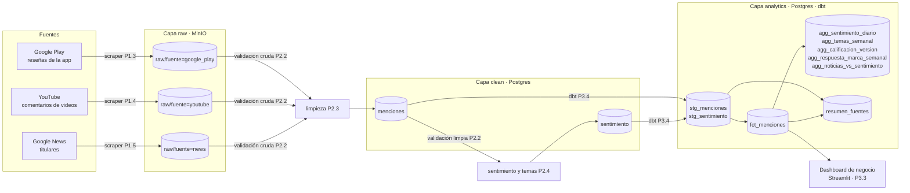

# Linaje de datos

**Paquete:** P3.5 Gobierno, linaje y cierre · **Autora:** Michelle · **Coautora:** Katalina · **Revisor:** Gabriel

Recorrido de una mención desde que se publica en Google Play, YouTube o Google News hasta que aparece en el dashboard. Cada caja es un conjunto del [catálogo de datos](catalogo_datos.md); cada flecha, el código que lo transforma.

## Diagrama



**Quién mueve los datos.** Prefect (P2.1) ejecuta toda la cadena en un solo flujo por fuente: extracción → validación cruda → limpieza → validación limpia → sentimiento → modelos de dbt. Las noticias corren cada 2 horas, Google Play cada 3 y YouTube cada 6. Si una validación crítica falla, el flujo se detiene: la cruda impide que los datos lleguen a clean, y la limpia, que pasen al sentimiento y a analytics.

**Quién lo vigila.** Al terminar cada corrida, el flujo publica sus métricas en el Pushgateway (P3.1). Prometheus las guarda y Grafana (P3.2) las muestra y avisa por correo con las alertas A1–A8. Esa información describe al pipeline, no a las personas, así que no forma parte del linaje de los datos.

## Paso a paso

| # | De | A | Código | Qué cambia en el dato | Clave que se conserva |
| --- | --- | --- | --- | --- | --- |
| 1 | Plataforma | raw | `src/ingestion/<fuente>/scraper.py` | Se pasa al contrato común; el nombre del autor se convierte en `autor_hash` (SHA-256 con sal); se descartan los campos fuera del contrato | `id_registro = <fuente>:<id_original>`, `run_id` |
| 2 | raw | (sin cambios) | `quality/checkpoints.py:validar_cruda` | Nada: comprueba columnas, tipos, rangos y unicidad. Una falla crítica detiene el flujo | |
| 3 | raw | `clean.menciones` | `src/transform/clean/limpieza.py:limpiar` | Normaliza el texto, enmascara datos personales, deja la versión más reciente de cada registro, detecta el idioma y marca bots. El texto original no pasa a clean | `id_registro`, `run_id`, `hash_texto` |
| 4 | `clean.menciones` | (sin cambios) | `quality/checkpoints.py:validar_limpia` | Nada: comprueba las garantías de `contrato_clean.md` | |
| 5 | `clean.menciones` | `clean.sentimiento` | `src/transform/nlp` | Calcula sentimiento y tema de las menciones en español que no son bots | `id_registro`, `hash_texto` |
| 6 | clean | analytics | `flows/modelos.py` → `dbt build` (P3.4) | Vistas de staging; `fct_menciones` une menciones y sentimiento vigente, quita los bots y pasa la fecha a hora de Colombia; las tablas `agg_` agregan por día, semana, tema, versión de la app y respuesta de Rappi | `id_registro` en `fct_menciones` |
| 7 | `analytics.fct_menciones` | Dashboard | `dashboard/app.py` (P3.3) | Filtra por fecha y fuente y muestra tendencias, top de quejas y ejemplos con correos y teléfonos tapados, sin autor ni identificador | |

## Cómo rastrear una mención

Con el `id_registro` se puede seguir una mención por todas las capas:

```sql
-- Capa clean: texto limpio, bots y versión de la limpieza
select id_registro, run_id, version_limpieza, es_bot, motivo_bot, hash_texto
from clean.menciones where id_registro = 'google_play:<reviewId>';

-- Sentimiento: con qué modelo y sobre qué texto se calculó
select s.sentimiento, s.tema, s.version_modelo, s.hash_texto = m.hash_texto as vigente
from clean.sentimiento s join clean.menciones m using (id_registro)
where id_registro = 'google_play:<reviewId>';
```

Con el `run_id` se encuentra el archivo raw de origen: `raw/fuente=<fuente>/fecha=<fecha de extracción>/run_<run_id>.jsonl`.

## Linaje automático

- **Capa analytics:** `make dbt-docs` abre en http://localhost:8080 la documentación de dbt con el linaje de cada modelo, desde las fuentes `clean.menciones` y `clean.sentimiento`.
- **Corridas:** cada ejecución del flujo queda registrada en Prefect con sus etapas, duración y resultado, y cada fila guarda el `run_id` y las versiones del código que la produjo (ver "Metadatos de trazabilidad" en el catálogo).
